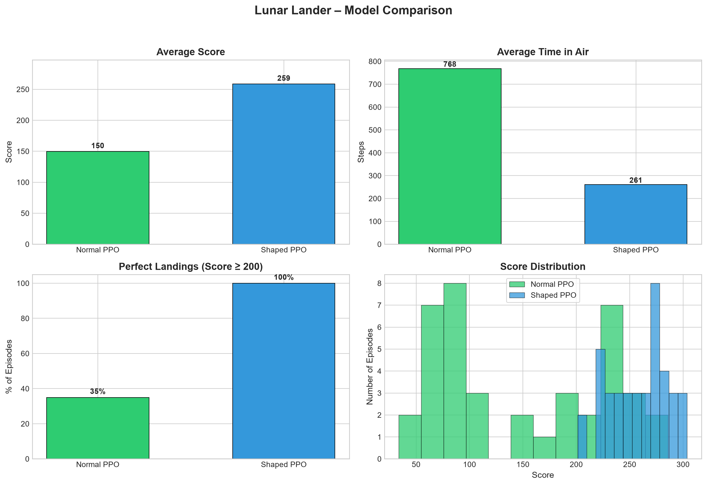

# Rocket AI – Lunar Lander with PPO & Reward Shaping

Train a PPO agent to land the Lunar Lander using **Gymnasium** and **Stable-Baselines3**.  
This project compares a standard reward with a **shaped reward** that encourages soft, controlled landings.



## Results Summary

| Metric                        | Normal PPO | Shaped PPO |
|-------------------------------|------------|------------|
| Average Score                 | 150        | **259**    |
| Perfect Landings (score ≥ 200)| 35%        | **100%**   |
| Average Time in Air (steps)   | 768        | **261**    |

The shaped agent lands faster, more consistently, and with much higher scores.

## Before Training

https://github.com/user-attachments/assets/413cc8cf-4a3f-465c-9e87-587f1098b5d8

## After Training

https://github.com/user-attachments/assets/bd7dea63-81dc-4d94-aca7-42b2c99d8737


## Project Structure

```
rocket-ai/
├── models/
│   ├── ppo_lunarlander.zip          # Pre-trained standard PPO
│   └── ppo_lunarlander_shaped.zip   # Pre-trained shaped PPO
├── results/
│   └── After Training.mp4           # Video results after training the model
│   └── Before Training.mp4          # Video results before the model was trained
│   └── Charts.png                   # Comparison charts
├── scripts/
│   ├── reward_wrapper.py            # Custom reward shaping wrapper
│   ├── train.py                     # Train standard PPO
│   ├── train_shaped.py              # Train PPO with shaped rewards
│   ├── watch_random.py              # Watch a random agent
│   ├── watch_trained.py             # Watch the standard PPO model
│   ├── watch_shaped.py              # Watch the shaped PPO model
│   └── charts.py                    # Generate comparison charts
├── requirements.txt
├── LICENSE
└── README.md
```

## Setup

```bash
# Clone the repo
git clone https://github.com/Rsharma225/rocket-ai.git
cd rocket-ai

# Create a virtual environment (recommended)
python -m venv venv
source venv/bin/activate   # Windows: venv\Scripts\activate

# Install dependencies
pip install -r requirements.txt
```

> **Note:** `gymnasium[box2d]` requires the Box2D physics engine.  
> On some systems you may need extra system packages:
> ```bash
> # Ubuntu/Debian
> sudo apt-get install swig
> # macOS (Homebrew)
> brew install swig
> ```

## Training

Train the **standard** PPO agent:

```bash
cd scripts
python train.py
```

Train the **shaped-reward** PPO agent:

```bash
python train_shaped.py
```

Both scripts train for 1 000 000 timesteps and save the models as:

- `ppo_lunarlander.zip`
- `ppo_lunarlander_shaped.zip`

Training usually takes 15–40 minutes on a typical laptop CPU.

Pre-trained models are already included in the `models/` folder.

## Watching the Agents

```bash
cd scripts

# Random policy (for fun / baseline)
python watch_random.py

# Standard PPO
python watch_trained.py

# Shaped PPO (best results)
python watch_shaped.py
```

A live score overlay is shown in the top-left corner of the window.

## Generating Charts

```bash
cd scripts
python charts.py
```

This evaluates both models and saves a new comparison chart.

## Reward Shaping Explained

The custom wrapper (`reward_wrapper.py`) modifies the default LunarLander reward:

1. **Time penalty** (`-0.05` per step) – encourages faster landings.
2. **Touchdown bonus** (up to `+25`) – awarded the first time both legs touch the ground.  
   The bonus is scaled by landing quality:
   - low horizontal velocity
   - low vertical velocity
   - small angle from upright
   - low angular velocity

This dense feedback makes it much easier for the agent to learn soft, precise landings.

## Requirements

- Python ≥ 3.9
- gymnasium[box2d]
- stable-baselines3
- pygame
- numpy
- torch
- matplotlib

See `requirements.txt` for exact versions.

## License

MIT
